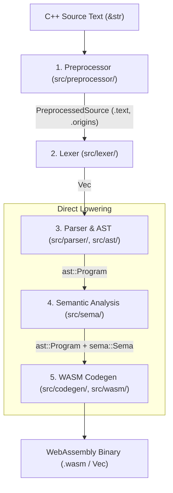

# Compiler Architecture

`cppwasm` is organized as a single Cargo package that provides a core compiler library (`cppwasm`), a native CLI (`cppwasm-cli`), a corpus test runner (`cppwasm-testrunner`), and a code metrics scanner (`cppwasm-census`).

The core library is entirely OS-agnostic and dependency-free: it performs no direct filesystem I/O, spawns no child processes, and requires no multi-threading runtime. Host environments supply include files through the [`IncludeProvider`](../../../src/source.rs) trait.

The release WebAssembly compiler module built for `wasm32-unknown-unknown` is currently 842,723 bytes raw and 244,401 bytes with `gzip -9 -n`.

---

## 1. High-Level Pipeline

The compiler follows a direct, five-stage pipeline:



### ASCII Pipeline Diagram

```text
 +-----------------------------------------------------------------+
 | C++ Source Text (&str, filename)                                |
 +-----------------------------------------------------------------+
                                  │
                                  ▼
 +-----------------------------------------------------------------+
 | 1. Preprocessor (src/preprocessor/)                             |
 |    - Macro expansion (hide sets, ##, #) & rescan                |
 |    - Conditional evaluation (#if, #elif, #ifdef)                |
 |    - IncludeProvider resolution & cycle detection               |
 |    - Origin line mapping for header diagnostics                 |
 +-----------------------------------------------------------------+
                                  │
                                  ▼ PreprocessedSource
 +-----------------------------------------------------------------+
 | 2. Lexer (src/lexer/)                                           |
 |    - Tokenization into TokenKind variants                       |
 |    - Exact source span tracking (Span: FileId, line, col, len)  |
 +-----------------------------------------------------------------+
                                  │
                                  ▼ Vec<Token>
 +-----------------------------------------------------------------+
 | 3. Parser & AST (src/parser/, src/ast/)                         |
 |    - Feature pre-scan (src/parser/unsupported.rs)               |
 |    - Recursive descent + Pratt expression parser                |
 |    - Nesting depth budgeting (src/depth.rs)                     |
 +-----------------------------------------------------------------+
                                  │
                                  ▼ ast::Program
 +-----------------------------------------------------------------+
 | 4. Semantic Analysis (src/sema/)                                |
 |    - Scopes, symbol registration, using/typedef aliases         |
 |    - Inheritance & vtable slot calculation                      |
 |    - Record layout computation (alignment & padding)            |
 |    - Overload resolution ranking & type checking                |
 |    - C++17 copy elision tagging                                 |
 +-----------------------------------------------------------------+
                                  │
                                  ▼ ast::Program + sema::Sema
 +-----------------------------------------------------------------+
 | 5. WASM Code Generation (src/codegen/, src/wasm/)               |
 |    - Direct AST-to-Wasm instruction lowering (NO IR)            |
 |    - Function context, local frame allocation                   |
 |    - Fixed-width LEB128 frame-size patching                     |
 |    - RAII deterministic scope cleanup emission                  |
 |    - Binary section encoding (src/wasm/)                        |
 +-----------------------------------------------------------------+
                                  │
                                  ▼
 +-----------------------------------------------------------------+
 | Emitted WebAssembly Binary (Vec<u8>)                            |
 +-----------------------------------------------------------------+
```

---

## 2. Direct AST-to-Wasm Lowering (No IR, No Optimizer)

A fundamental architectural decision in `cppwasm` is the **complete absence of an Intermediate Representation (IR)** and an optimization pass (see [ADR 0002](../../adr/0002-direct-wasm.md)).

- **Traditional Compilers**: Typically translate `AST -> High-Level IR -> Low-Level IR (SSA / 3-Address Code) -> Machine Instructions`, running dozens of optimization passes in between.
- **`cppwasm` Architecture**: Lowers the annotated Abstract Syntax Tree (`ast::Program`) and semantic state (`sema::Sema`) **directly into WebAssembly instruction bytes**.
- **Why No IR?**
  - Keeps the compiler's own compiled WebAssembly payload extremely small (~244 KB gzipped).
  - Maximizes compilation throughput in browser Web Workers.
  - Eliminates the memory allocation overhead of building and tearing down intermediate CFG or SSA graphs.
- **Why No Optimizer?**
  - Prioritizes compiler correctness, determinism, and transparent mapping to WebAssembly primitives.
  - Generating unoptimized code is an intentional scope boundary for v1 (documented in [`known-limitations.md`](../user/supported-cpp.md#known-limitations--design-rules)).

---

## 3. Compiler Pipeline Stages

| Stage | Path | Purpose | Input Type | Output Type | Key Data Structures | Invariants |
|---|---|---|---|---|---|---|
| **Preprocessor** | [`src/preprocessor/`](../../../src/preprocessor/) | Macro expansion, include resolution, `#if` evaluation | `&str`, `&dyn IncludeProvider` | `PreprocessedSource` | `MacroDef`, `HideSet`, `LineOrigin` | Include recursion capped at 128; macro recursion terminates via hide sets; origins accurately track header lines |
| **Lexer** | [`src/lexer/`](../../../src/lexer/) | Tokenizes preprocessed text into lexemes | `&str` | `Vec<Token>` | `Token`, `TokenKind`, `Span`, `FileId` | Every token carries an exact non-fabricated source span |
| **Parser & AST** | [`src/parser/`](../../../src/parser/), [`src/ast/`](../../../src/ast/) | Parses grammar into typed AST | `Vec<Token>` | `ast::Program` | `Program`, `Decl`, `Stmt`, `Expr`, `Type` | Validates supported features first; nesting depth bounded per construct via `depth.rs` |
| **Semantic Analysis** | [`src/sema/`](../../../src/sema/) | Scope analysis, type checking, vtables, layouts, overloads | `&mut ast::Program` | `sema::Sema` | `Sema`, `StructDef`, `FunctionSig`, `RecordLayout` | Mutates AST with resolved types; rejects multiple/virtual inheritance; catches ambiguous overloads |
| **WASM Codegen** | [`src/codegen/`](../../../src/codegen/), [`src/wasm/`](../../../src/wasm/) | Lowers AST to WebAssembly binary sections | `&ast::Program`, `&sema::Sema` | `Vec<u8>` | `Codegen<'a>`, `FunctionContext`, `WasmModule` | Fixed-width LEB128 frame patches; stack allocation traps on guard page entry; RAII cleanups on all exits |
| **Runtime** | [`src/runtime/`](../../../src/runtime/), [`stdlib/`](../../../stdlib/) | In-module allocator, printf runtime, embedded headers | N/A (Emitted or included) | Wasm opcodes | `memory_layout`, `allocator`, `format` | ILP32 32-bit addresses; stack top at `0x810000`; heap grows upward; slot 0 traps |

---

## 4. Binary and Library Targets

The repository contains a single unified Cargo package defined in [`Cargo.toml`](../../../Cargo.toml):

| Target | Entry File | Responsibility |
|---|---|---|
| `cppwasm` (lib) | [`src/lib.rs`](../../../src/lib.rs) | Core compiler pipeline, public Rust API, and C ABI entry points ([`src/ffi.rs`](../../../src/ffi.rs)) |
| `cppwasm-cli` (bin) | [`src/main.rs`](../../../src/main.rs) | Native command-line interface with filesystem include support and 64 MiB execution thread |
| `cppwasm-testrunner` (bin) | [`src/bin/cppwasm-testrunner.rs`](../../../src/bin/cppwasm-testrunner.rs) | Corpus test runner, variant verification, native oracle execution, and golden baseline check |
| `cppwasm-census` (bin) | [`src/bin/cppwasm-census.rs`](../../../src/bin/cppwasm-census.rs) | Code quality scanner enforcing function line count (<80 lines) and parameter limits (<5 params) |
